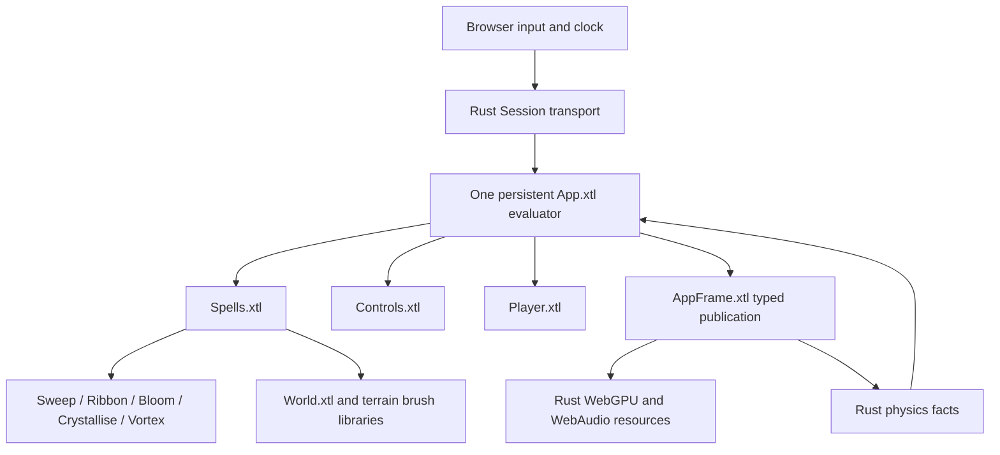

# How the sources connect

Think of App.xtl as the conductor. Rust provides the clock, keyboard, drawing
and sound equipment. The conductor chooses the players and tells them what to
do. The source panels show that actual application and its composition libraries.

## Where the program set is configured

[App.xtl](../components/world/demos/App.xtl) imports Spells.xtl with
`"spells:" u_se< "../libs/Spells.xtl"`. Its bindings value configures keys
1, 2, 3, 4 and 5. [Spells.xtl](../components/world/libs/Spells.xtl) imports the
actual spell libraries and dispatches those keys. Changing the fourth binding
to 9 changes the key that casts Crystallise without changing Rust; an executable
[composition test](../components/session/crates/xetal-app-session/tests/composition.rs)
checks this behavior.

[Session](../components/session/crates/xetal-app-session/src/session.rs) embeds
App.xtl once and loads it through Demo::from_source. The source's final expression
starts u:l_oop!. Rust never looks up a function named loop. It resumes the saved
machine until the next Event wait, then supplies another queued event.

## Ribbon, one message at a time

1. The browser forwards a key-down event for 2. App.xtl passes it to Spells.xtl.
2. Spells uses its configured binding to call Ribbon's press function with the
   current pose. Ribbon returns a new immutable state.
3. Native animation frames send elapsed time, coalesced to roughly 20 updates
   per second. App.xtl advances the libraries and publishes typed resource data.
4. RibbonSurface turns the saved path into triangles. Rust validates the
   published water material capability and uploads changed geometry to WebGPU.
5. Releasing 2 reaches the same X_eTaL dispatch and calls Ribbon's release.
   A later ground probe asks Rust for a terrain fact. The X_eTaL callback decides
   whether to score the snow, and World.xtl records that edit.

## Ownership and current limits

Controls owns bindings, pause/reset, movement intent and camera increments.
Player owns footfalls, wind aging and sequenced sound commands. World owns brush
histories and dirty regions. Spells owns spell selection, dispatch and resource
revisions. AppFrame describes the buttons and source panels shown by the host.

Rust owns native physics integration, chunk residency, GPU/audio resources and
browser scheduling. It supports three material capabilities: ice, slush and
water. Adding a new material or host service requires extending that backend;
adding a spell using existing capabilities does not require a native dispatcher.

The libraries execute in one interpreted X_eTaL machine compiled into the Rust
WASM application, currently on the browser main thread. They are not separately
compiled to WASM or GPU kernels. Worker execution remains future work.

The Event bridge carries scalar facts with scratch packets: move supplies x/z,
down supplies y/impact or y/found, up supplies aim, choose supplies a flag.
Click commits a pose (1), requests a chunk (2), answers a query (3), acknowledges
a world revision (4), or releases held controls on blur (5). Key and tick carry
physical keys and elapsed seconds. This is a documented application adapter,
not the pending generic E1 typed host registration API.

The 12-field publication contains terrain, material resources, particles,
footprints, sequenced audio, statistics, physics requests, buttons, navigation,
world revision/dirty bounds, source panels and protocol version. Dense numeric
data stays typed. Only frame! is mutable; logical state is passed through pure
functions. Old individual demo runners remain reference oracles, outside live
application composition. See the [library cross-reference](libraries.md).
