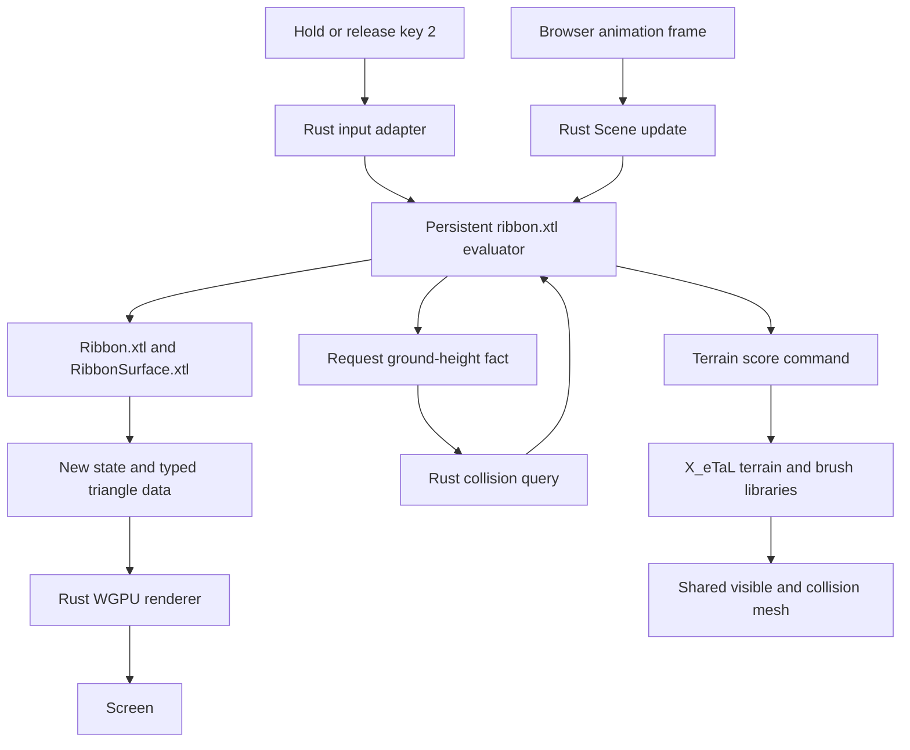

# How the sources connect

Think of the app as a clock, several little machines, and a drawing desk.
The Rust browser loop is the clock. Each X_eTaL program is a machine that stays
loaded, remembers its state, and waits for messages. The Rust/WGPU renderer is
the drawing desk: it displays the geometry the programs produce.

## Ribbon, one message at a time

1. During startup, [Scene::new](../components/app/crates/xetal-snow-app/src/scene.rs)
   creates a Ribbon instance. Its [constructor](../components/effects/crates/xetal-world-ribbon/src/transport.rs)
   loads the actual embedded `ribbon.xtl` source into a persistent evaluator.
   It is loaded once, not restarted each frame.
2. Holding 2 reaches the [input adapter](../components/app/crates/xetal-snow-app/src/input.rs),
   then `Scene::ribbon_input`, then the native `Ribbon::press` method. The
   [native input wrapper](../components/effects/crates/xetal-world-ribbon/src/input.rs)
   supplies pose facts and a start message. Releasing the key sends a release message.
3. The [X_eTaL composition program](../components/world/demos/ribbon.xtl) wakes
   from `host:n_ext!`, examines the message and calls its imported
   [Ribbon library](../components/world/libs/Ribbon.xtl). That library owns
   holding, tip motion, history, release direction and retirement.
4. On each browser animation frame, [App::tick and App::advance](../components/app/crates/xetal-snow-app/src/frame.rs)
   call `Scene::update`. Its [advance_spells helper](../components/app/crates/xetal-snow-app/src/effects.rs)
   supplies current pose and elapsed time to each spell adapter.
   Ribbon coalesces time updates to about 20 per second; GPU drawing can happen
   on every browser animation frame, reusing the latest geometry.
5. The spell computes its next immutable state. [RibbonSurface](../components/world/libs/RibbonSurface.xtl)
   turns the saved tip path into a triangle array. The composition program
   publishes `(mesh, score, probe, status)` through `frame!`, then waits again.
6. The [native output adapter](../components/effects/crates/xetal-world-ribbon/src/output.rs)
   reads and validates those numeric arrays. The browser app uploads changed
   triangles and calls the renderer. The shader handles material lighting.
   A score command instead goes to the terrain program and its brush libraries.

## What is currently Rust, and what is X_eTaL?

The outer scheduler is currently Rust. The world source shown in the first panel
does not itself call every spell. Terrain, player footsteps/audio policy and
each spell run as separate persistent evaluators within the same Rust/WASM app.
They currently execute on the browser main thread, not separate worker threads.

X_eTaL programs contain the algorithms and gameplay rules. Their imported `.xtl`
files are real library dependencies, resolved by the embedded source catalog.
These programs are interpreted by the Rust evaluator compiled to WASM; they are
not individually compiled to native WASM or GPU shaders in this implementation.

The source panels show copies of the same embedded program text that startup
loads. Rendering that text with typography and syntax colors is a separate UI
operation; it does not execute the displayed panel as a second game.

The bridge currently sends a few scalar input facts through queued Event messages
and reads typed output arrays through the captured publication slot. `frame!` is
that publication slot, not the spell's logical state. The state is passed into
pure functions, and those functions return its successor. This adapter is not
the still-pending generic E1 typed host registration API.

See [library cross-reference](libraries.md) for source, backend and test mappings.
